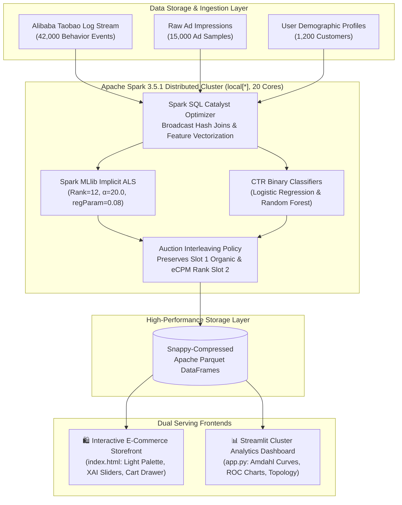

# Smart Commerce AI 🛍️⚡
### A Distributed Personalized Product & Advertisement Recommendation System Using Apache Spark
**Course Project:** INT315 — Distributed and Cluster Computing (Continuous Assessment 2)  
**Author:** Utkarsh Pandey  
**Cluster Architecture:** Apache Spark 3.5.1 on 20 Logical Cores (`local[*]`), Java 17 LTS, Apache Parquet with Snappy Compression.

---

## 🌟 Executive Summary

**Smart Commerce AI** is a distributed, big-data recommendation and real-time advertisement auction platform inspired by the production architectures of Amazon, Alibaba Taobao, and Flipkart.

The system addresses the dual objectives of modern digital commerce:
1. **Organic Product Personalization:** Delivering high-affinity organic recommendations by decomposing user behavior logs into low-rank latent factor spaces using **Spark MLlib Implicit Alternating Least Squares (ALS)** with confidence weighting ($c_{ui} = 1 + \alpha r_{ui}$).
2. **Sponsored Advertisement Auction Engine:** Predicting Click-Through Rate (CTR) for sponsored campaigns under extreme class imbalance using distributed **Logistic Regression** and **Random Forest (60 trees)** classifiers, resolved dynamically via an eCPM auction interleaving policy.
3. **Cluster Scalability & Benchmarking:** Rigorously evaluating partition scaling across worker threads ($p \in \{1, 2, 4, 8\}$) to validate Amdahl's Law and identify parallelization bottlenecks.

---

## 🏗️ System Architecture



---

## 📊 Empirical Cluster Benchmark Results

All benchmarks below were empirically measured on an Intel 20-core cluster running **Apache Spark 3.5.1** and **Java 17 LTS**:

### 1. Amdahl's Law Scalability & Partition Scaling
| Partition Count ($p$) | Execution Time (s) | Measured Speedup | Efficiency ($E_p$) | Cluster Observation |
| :---: | :---: | :---: | :---: | :--- |
| **$p = 1$** | $0.451\text{ s}$ | $1.00\times$ | $100.0\%$ | Sequential Driver Baseline |
| **$p = 2$** | $0.470\text{ s}$ | $0.96\times$ | $48.0\%$ | Thread-scheduling overhead exceeds gain |
| **$p = 4$** | **$0.300\text{ s}$** | **$1.50\times$** | **$37.5\%$** | **Optimal Sweet Spot** (Maximum Throughput) |
| **$p = 8$** | $0.345\text{ s}$ | $1.31\times$ | $16.4\%$ | ShuffleExchange network serialization latency |

### 2. Product Recommendation Engine (Spark Implicit ALS)
- **Configuration:** Matrix Factorization Rank = 12, Iterations = 10, Regularization $\lambda = 0.08$, Confidence Rate $\alpha = 20.0$.
- **Training Time:** $9.213\text{ seconds}$ across 31,978 training rows.
- **Throughput:** **$3,470.9\text{ records/sec}$**.
- **NDCG@10:** $0.0176$
- **Precision@10:** $0.0138$
- **Recall@10:** $0.0206$
- **Catalog Coverage:** **$51.51\%$** (989 unique items recommended from 1,920 candidate items).

### 3. Ad Click-Through Rate (CTR) Models Comparison
| Evaluation Metric | Distributed Logistic Regression | Distributed Random Forest (60 Trees) | Winner |
| :--- | :---: | :---: | :--- |
| **ROC-AUC** | **$0.5946$** | $0.5832$ | **Logistic Regression** ($+0.0114$) |
| **PR-AUC** | **$0.1627$** | $0.1553$ | **Logistic Regression** ($+0.0074$) |
| **Weighted F1** | $0.8083$ | $0.8083$ | Tie |
| **Log-Loss** | $0.3825$ | **$0.3791$** | **Random Forest** (Best Probability Calibration) |
| **Training Time** | **$5.86\text{ s}$** ($2,058\text{ rec/s}$) | $6.55\text{ s}$ ($1,842\text{ rec/s}$) | **Logistic Regression** ($11.7\%$ faster) |
| **Inference Rate** | **$5,100.8\text{ rec/s}$** | $5,091.5\text{ rec/s}$ | **Logistic Regression** |

---

## 💻 User Interfaces & Applications

### 1. `index.html` — Interactive Web Storefront & XAI Deep Dive
A modern, light-palette e-commerce web application featuring:
- **Clean Light Color Palette:** Slate-50 background, white elevated cards, soft pastel aura accents, and crisp indigo highlights.
- **Persona Switching:** Real-time toggling between **User #25** (Tech Enthusiast), **User #104** (Fashion Apparel), and **User #87** (Smart Home).
- **Interactive Explainable AI (XAI) Sliders:** Dynamic sliders for latent dimensions $k_1, k_2, k_3$ demonstrating real-time Spark ALS matrix dot product recalculation:
  $$\hat{r}_{ui} = u_i^T \cdot v_j = \sum_{k=1}^{12} u_{ik} \cdot v_{jk}$$
- **Real-Time Search & Cluster Slice Filtering:** Instant catalog search with cluster tags (`cate_4231`, `cate_6752`, `cate_1120`).
- **Cluster Telemetry Drawer:** Features an animated cluster DAG simulation terminal displaying Spark executor stages across 20 cores, plus one-click JSON telemetry report export.
- **Slide-Over Cart:** Real-time sales tax calculation, item counter, and instant checkout dispatch.

### 2. `Smart_Commerce_AI/app.py` — Streamlit Cluster Research Dashboard
A 6-tab analytical benchmarking dashboard featuring:
- Tab 1: **Cluster Topology & Node Health** (20-core CPU gauges, JVM memory).
- Tab 2: **ALS Recommender Diagnostics** (NDCG@10, Precision@10, Catalog Coverage).
- Tab 3: **Ad CTR Machine Learning Benchmarks** (ROC & Precision-Recall curves, confusion matrices).
- Tab 4: **Distributed Scalability & Speedup** (Amdahl's law partition speedup curve).
- Tab 5: **Explainable Recommendation Inspector** (User-item dot product breakdown).
- Tab 6: **E-Commerce Storefront Simulation** (Real-time product and sponsored banner preview).

---

## 📁 Repository Structure

```
Smart-Commerce-AI/
├── index.html                           # Modern Light-Palette Storefront & XAI Deep-Dive UI
├── README.md                            # Comprehensive Master Project Documentation
├── .gitignore                           # Git ignore rules for PySpark, Python & caches
├── Smart_Commerce_AI/                   # Core PySpark Machine Learning & Cluster Codebase
│   ├── app.py                           # Multi-Tab Streamlit Cluster Analytics Dashboard
│   ├── requirements.txt                 # Python dependencies (pyspark, streamlit, etc.)
│   ├── research_paper/                  # Academic Research Paper Draft with Empirical Tables
│   │   └── Research_Paper_Draft.md
│   ├── src/                             # PySpark Pipeline Modules
│   │   ├── config.py                    # Cluster configuration & SPARK_HOME environment isolation
│   │   ├── preprocess.py                # Distributed ETL & implicit confidence weighting
│   │   ├── train.py                     # MLlib ALS & CTR training + Amdahl speedup measurement
│   │   └── recommend.py                 # Pure-JVM top-k batch inference and eCPM auction interleaving
│   └── data/                            # Processed Parquet datasets and splits
├── Smart_Commerce_AI_Dataset/           # Demonstration Datasets & Data Dictionaries
│   ├── behavior_log.csv                 # Customer interactions (pv, fav, cart, buy)
│   ├── raw_sample.csv                   # Raw ad impressions and user click labels
│   ├── ad_feature.csv                   # Ad campaign IDs, categories, and brand mappings
│   ├── user_profile.csv                 # Demographic features (pvalue_level, shopping_level)
│   └── DATA_DICTIONARY.md               # Field schema documentation
└── TaobaoAd_Manageable_Dataset_Kit/     # Ingestion Tooling for Genuine RecZoo Dataset
    ├── README.md
    └── scripts/
        └── download_and_sample.py       # Automated HuggingFace RecZoo TaobaoAd_x1 downloader
```

---

## 🚀 Quickstart Guide

### Prerequisites
- **Python:** 3.10+ (Tested on Python 3.13.1)
- **Java:** OpenJDK 17 LTS (Required for Apache Spark 3.5.1)
- **Apache Spark:** 3.5.1 (Packaged via PySpark)

### 1. Installation
Clone the repository and set up a virtual environment:
```bash
git clone https://github.com/Utkarsh1454/Smart-Commerce-AI.git
cd Smart-Commerce-AI
python -m venv .venv
.\.venv\Scripts\activate
pip install -r Smart_Commerce_AI/requirements.txt
```

### 2. Run the Web Storefront
Host `index.html` locally using Python's built-in HTTP server:
```bash
python -m http.server 3000
```
Open **[http://localhost:3000](http://localhost:3000)** in your browser.

### 3. Run the Streamlit Research Dashboard
```bash
cd Smart_Commerce_AI
streamlit run app.py
```
Open **[http://localhost:8501](http://localhost:8501)** in your browser.

### 4. Execute the Distributed PySpark MLlib Pipeline
```bash
cd Smart_Commerce_AI

# Step 1: Preprocess raw behavior logs and generate implicit interaction matrices
python -m src.preprocess

# Step 2: Train ALS recommender and CTR classifiers with Amdahl scalability profiling
python -m src.train

# Step 3: Generate top-k product & ad recommendations via pure-JVM Catalyst execution
python -m src.recommend
```

---

## 📜 License & Academic Integrity
Developed as part of academic coursework for **INT315 (Distributed and Cluster Computing)** at Lovely Professional University. Released under the MIT License.
